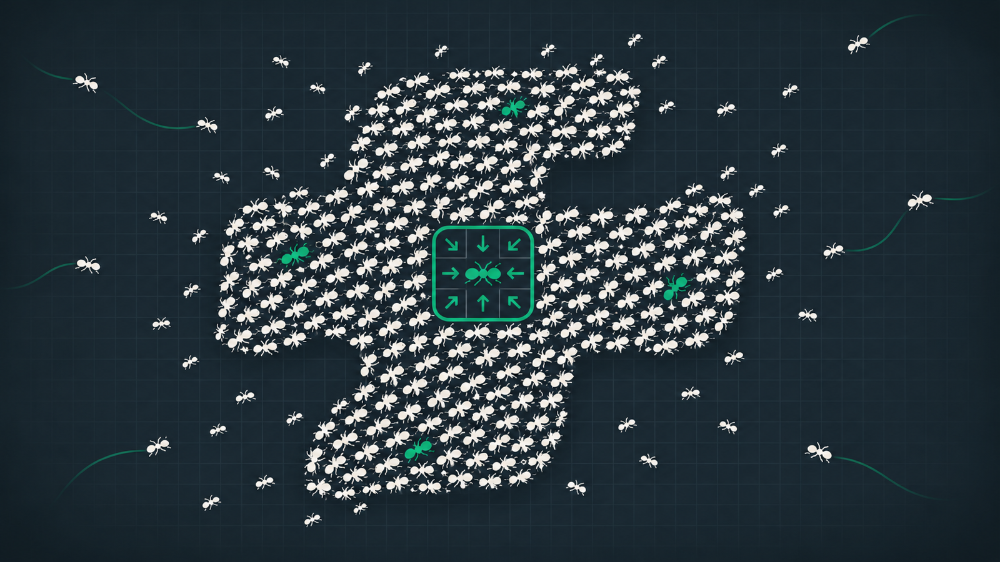

<h1 align="center">Jev Ants</h1>

<p align="center"><strong>Ants that form the picture you type, one decision at a time.</strong></p>
<p align="center">Every ant is its own <a href="https://typesafe.ai">Jev</a> agent. A thousand small local decisions turn a scatter into a word or an image.</p>

<p align="center">
  
  
  
  <a href="LICENSE"></a>
</p>

<p align="center">
  
</p>
<!-- TODO: generate docs/hero.png from docs/hero-image-prompt.md -->

<p align="center"><sub><em>A thousand ants, each asking Jev "which way?", settle into the picture you asked for.</em></sub></p>

## Features

- **Type a word or drop an image.** Two lines of text make two rows; black-and-white pictures work best, and a target preview shows what the ants are asked to draw.
- **One agent per ant.** Each ant sees the nine cells around it, how many ants each still wants, and its neighbours' headings. Jev answers *which way* and *whether to settle*.
- **Morph between pictures.** Change the target while stopped and the ants walk from the old shape into the new one.
- **Image overseer.** Every 4 s Jev looks at the field and the target as two PNGs and returns a box where ants are most lacking, used as an attractor.
- **Cost and time caps.** Spend is metered from the real `usage.input_tokens` of every reply; runs stop at the spend cap (default $0.50) or time cap (default 3 min).
- **Local-rule baseline.** A free greedy gradient-walk brain for comparison.
- **Overlays** for the deficit heatmap and pheromone trails.

## How it works

1. The target (text or image) becomes a grid of how many ants each cell wants. Wherever ants stand, the grid's **deficit** says which cells want more and which have too many.
2. Each ant's state is small: a 3x3 deficit window (its own cell in the centre), whether its cell has `room` for it, local `crowd`, its `heading`, its neighbours' headings, and a direction toward far-away want or the overseer's box.
3. One request carries about a hundred ants as a JSON object with one key per ant. Each ant gets its own `choice` (eight compass directions or stay) and its own `noul` (settle). Jev evaluates each question against the state independently, so a packed request costs the same as a hundred single ones but takes one round trip (~300 ms). Six requests run in parallel, the browser's per-host connection limit.
4. Answers become moves. From a random scatter, about five decisions per ant produce the picture in roughly fifteen seconds. A formed picture costs nothing to hold.

| | per ant | per 1,000-ant formation |
|---|---|---|
| State | ~45 tokens | |
| Compass choice + settle noul | ~250 tokens | |
| Decisions needed | ~5 | ~1.7 M tokens |
| Cost at $0.042 / M input tokens | | **≈ $0.07** |

Output tokens are free. The overseer adds about 1,300 tokens per look. The schema bake-off and the measured token budget are in [docs/PRD.md](docs/PRD.md).

## Get started

```sh
export JEV_API_KEY=...      # your TypeSafe key; the browser never sees it
cd web && npm install && npm run dev
open http://localhost:38500
```

The dev server is the app: Vite serves the React front end, and a small middleware holds the key, forwards packed requests to `api.typesafe.ai`, and enforces the spend and time caps.

## Usage

- **Start Jev.** Ants scatter and Jev steers them. The panel shows running cost, tokens, latency, requests in flight, and one ant's live state and answer.
- **Stop** any time, or let it stop itself: when the picture is formed, or at the spend or time cap.
- **Morph** after changing the picture while stopped. **Scatter** replays a formation from scratch.
- **Local rule** switches to the free greedy brain.

## Hosting

Build the front end (`npm run build`), serve `web/dist` statically, and run the same handlers from `web/server/api.ts` behind any Node HTTP server with `JEV_API_KEY` in its environment. The handlers check `Origin` against the host and keep the key out of every response and log. All visitors share one spend ledger, so a hosted copy should lower the default caps.

## Development

```sh
cd web
npm test          # sim + server tests (node --test, native TS)
npm run lint      # oxlint
npx tsc -b        # types
```

`web/src/sim` is pure and testable headless; `web/server` is the proxy and ledger; `web/src/ui` is React and canvas. Work is tracked with [beads](https://github.com/steveyegge/beads) (`bd ready`).

## License

[MIT](LICENSE) © Aaron Brooks
